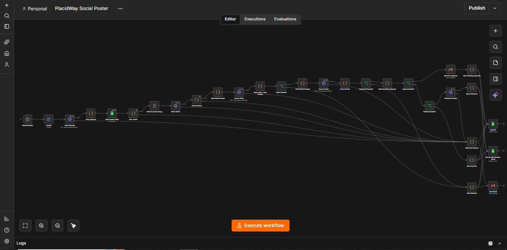
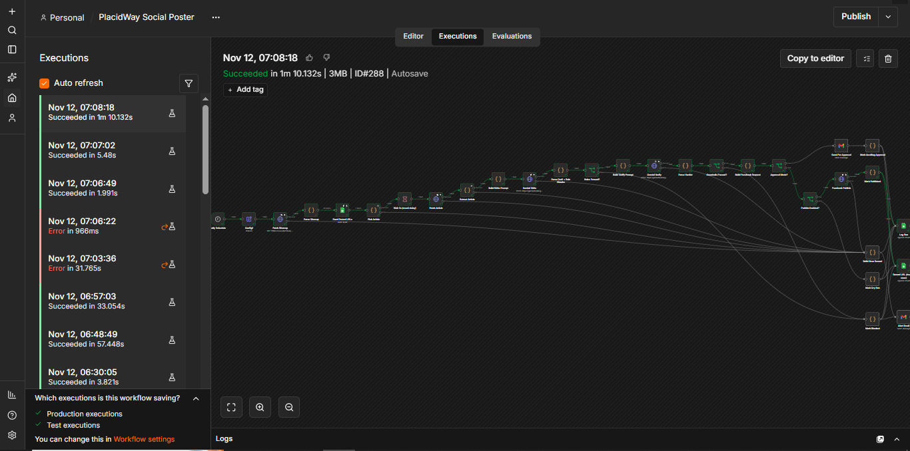
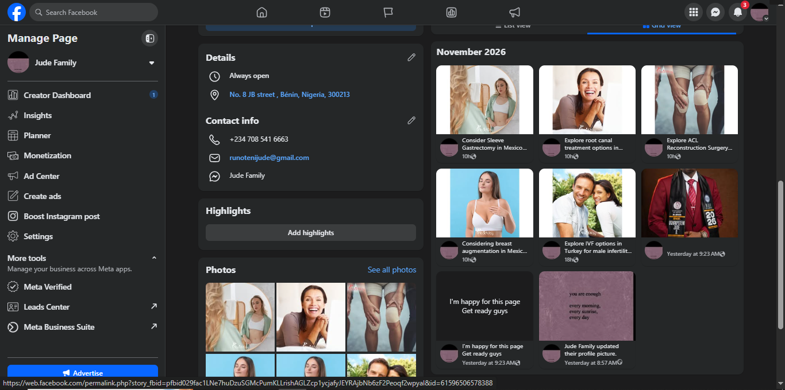
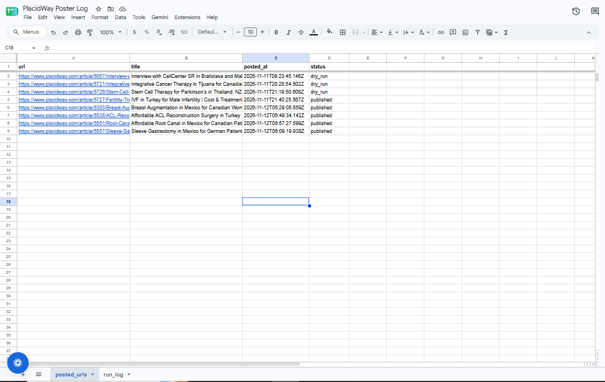

# PlacidWay Social Poster (n8n)

A daily n8n workflow that picks one public PlacidWay article, has Gemini write a short Facebook post from it, checks the post twice (rule-based code, then a second Gemini pass), and publishes it to a **test Facebook Page created with my sister's help, on which I hold full admin access**. It can also run as a dry run (logs the exact request, posts nothing) or in approval mode (emails the draft, posts nothing). Every run is logged to Google Sheets, and failures send an alert email instead of failing silently.

Built for the PlacidWay AI Automation assessment (Task 1: Social Media Content Automation Workflow).

**Demo video (5-10 min):** (https://youtu.be/VctUFCw3gcE)

Built by Jude Ughakpoteni ([LinkedIn](https://linkedin.com/in/jude-ughakpoteni-337393413)).

## Requirements checklist

| Requirement | How it is met | Nodes |
|---|---|---|
| Runs daily, plus manual test run | Schedule trigger (09:00) and a manual trigger | `Daily Schedule`, `Manual Trigger` |
| Extract title, URL, body, image | Sitemap for discovery, then one article page per run | `Fetch Sitemap`, `Parse Sitemap`, `Fetch Article`, `Extract Article` |
| One item per run, never the same URL twice | First unposted, eligible URL; every run is recorded in a sheet | `Read Posted URLs`, `Pick Article`, `Record URL (dedupe store)` |
| LLM writes the post (hook, 2-4 lines, CTA, link, 3-5 hashtags, under 500 chars before the link) | Gemini with a strict prompt; the link is appended by code | `Build Write Prompt`, `Gemini Write`, `Parse Draft + Rule Checks` |
| Guardrails: no medical claims, promises, invented prices or facts | Rule check in code plus a second Gemini fact-check, fail closed | `Rules Passed?`, `Gemini Verify`, `Parse Verdict`, `Guardrails Passed?` |
| Publish to a test Facebook Page, with the image when one exists | Graph API: `/photos` with an image, `/feed` with a link otherwise | `Build Facebook Request`, `Facebook Publish` |
| Config flag for auto-publish vs approval | `mode` = `auto` or `approval` (plus `publish_enabled` for dry run) | `Config`, `Approval Mode?`, `Publish Enabled?`, `Send For Approval` |
| Logging and errors | Every path writes one `run_log` row; failures retry, then alert | `Log Run`, `Build Error Record`, `Alert Email` |

## Architecture

```
Manual Trigger / Daily Schedule
        -> Config (mode, publish_enabled, model, page id, sheet id, reviewer email)
        -> Fetch Sitemap (sitemap_articles.xml) -> Parse Sitemap (first 30 entries)
        -> Read Posted URLs (Google Sheet) -> Pick Article (first unposted, eligible)
        -> Wait 3s -> Fetch Article -> Extract Article (title, summary, image, source text)
        -> Gemini Write -> Parse Draft + Rule Checks
              rules fail -> Mark Blocked
        -> Gemini Verify (fact check vs source) -> Parse Verdict
              verify fails -> Mark Blocked
        -> Build Facebook Request
              mode = approval        -> email draft to reviewer -> Mark Awaiting Approval
              publish_enabled = true -> Facebook Graph API publish -> Mark Published
              otherwise              -> Mark Dry Run (logs the exact request)
        -> Log Run (run_log) + Record URL (posted_urls)
Any HTTP or extraction failure -> Build Error Record -> Log Run + Alert Email
```


## Screenshots








## Extraction method and why

I read PlacidWay's own `sitemap.xml`, which links to `sitemap_articles.xml`. It is the site's published list of public URLs, so there is no scraping of listing pages. It already gives the URL, date and a featured image, and I fetch only one article page per run for the title, description and body text.

| Option | Why not (or why) |
|---|---|
| **Sitemap (chosen)** | Official, stable, light. One request for the list, one for the article. |
| RSS | No feed was relied on; a sitemap is more likely to exist and stay current. |
| HTML listing parsing | Breaks whenever the page layout changes and needs more requests. |
| Headless browser | Heavy and slow for pages that render fine as plain HTML. |

robots.txt allows `/article/` and sets `Crawl-delay: 3`, so the workflow waits 3 seconds between requests (stricter than the 1 request per second required). Requests identify themselves with a clear User-Agent.

## Setup

1. Run n8n locally (`npx n8n`) and import `PlacidWay_Social_Poster.json`.
2. Create a Google Sheet with two tabs:
   - `posted_urls`: `url`, `title`, `posted_at`, `status`
   - `run_log`: `run_time`, `mode`, `article_url`, `post_text`, `facebook_post_id`, `status`, `detail`
3. Create credentials in n8n and attach them to the nodes that show a warning:

| Credential type | Used by | Notes |
|---|---|---|
| Header Auth | Gemini Write, Gemini Verify | Name `x-goog-api-key`, value = free key from Google AI Studio |
| Query Auth | Facebook Publish | Name `access_token`, value = **Page** access token |
| Google Sheets OAuth2 | Read Posted URLs, Log Run, Record URL | |
| Gmail OAuth2 | Send For Approval, Alert Email | |

4. Edit the **Config** node:

| Field | Meaning |
|---|---|
| `mode` | `auto` or `approval` |
| `publish_enabled` | `false` = dry run (default), `true` = post for real |
| `gemini_model` | `gemini-3.5-flash-lite` (change it if your key lists a different model) |
| `fb_page_id` | ID of the test Page |
| `fb_api_version` | Graph API version (v27.0 was used in testing) |
| `reviewer_email` | receives approval drafts and alerts |
| `sheet_id` | ID of the Google Sheet above |

### Facebook setup (short version)

1. Use a Facebook Page you administer (the Graph API cannot post to personal profiles). My own account was restricted from creating Pages, so my sister created the test Page and gave me full control of it.
2. Create a Meta developer app in Development mode with the "Manage everything on your Page" use case and the permissions `pages_manage_posts`, `pages_read_engagement`, `pages_show_list`. Development mode is enough for a Page I administer, so no App Review is needed.
3. In Graph API Explorer, generate a user token (select the Page when asked), then call `me/accounts` to get the Page ID, or choose the Page in the "User or Page" dropdown to get the **Page access token**. Tokens from the Explorer are short-lived (hours), so I generate a fresh one before each live run; a long-lived token is optional.
4. Store the Page token only in the n8n Query Auth credential. It is never written into the workflow file, this README or the repo.

## How to run

- **Dry run (default):** `publish_enabled = false`. Click Execute workflow. Nothing is posted, and the exact Facebook request is logged in `run_log.detail` (token omitted).
- **Live post:** set `publish_enabled = true` and run again. The post appears on the test Page, and the Facebook post ID is logged.
- **Approval mode:** set `mode = approval`. The draft is emailed to the reviewer and nothing is posted.
- The Daily Schedule trigger runs at 09:00 (n8n instance time zone) once the workflow is activated.

## Guardrails

1. **Prompt rules:** use only facts from the source, no medical claims, no promised outcomes, no prices or numbers that are not in the source, no URLs.
2. **Rule check (code):** at most 500 characters, 3-5 hashtags, banned words (cure, guarantee, miracle, risk-free, painless, "no side effects", "proven to", 100%), and any price, percentage or multi-digit number that does not appear in the source text.
3. **Second Gemini pass:** compares the post to the source and returns `{pass, issues}`. If the reply cannot be parsed, the post is blocked (fail closed).
4. A blocked post is never published, is logged with the reason, and triggers an alert email.

The link is appended by code, not by the model, so it can never be altered or invented. Topics such as addiction treatment, gender surgery, fertility donation and autism, and non-English pages, are skipped for this demo.

## Errors and retries

| Failure | What happens |
|---|---|
| Site slow or down (PlacidWay returned a 504 during testing) | HTTP nodes retry 3 times with a delay, then the error is logged and an alert email is sent |
| Gemini rate limit or timeout | Retries 3 times with a longer wait, then log and alert |
| Facebook error (expired token, missing permission) | Error output goes to `Build Error Record`: logged, alert email, nothing marked as posted |
| Guardrail failure | Post is blocked and logged with the reason; nothing is published |

## Sample output

Real posts generated from real PlacidWay pages. All three passed both guardrail checks and were published to the test Page; the Facebook post IDs come from `run_log`. The same samples are in `sample_output.md`.

**1. Dental. Source:** https://www.placidway.com/article/5551/Root-Canal-in-Mexico-A-Cost-Effective-Dental-Solution-for-Canadian-Patients
Facebook post ID: `1424954500698882_122097807201550219`

```
Explore root canal treatment options in Mexico for Canadian patients.
Learn about treatment options and what to expect.
Always consult a qualified medical professional before traveling.
Read the full article to learn more.

https://www.placidway.com/article/5551/Root-Canal-in-Mexico-A-Cost-Effective-Dental-Solution-for-Canadian-Patients

#PlacidWay #DentalTourism #MexicoDentistry #RootCanal
```

**2. Cosmetic. Source:** https://www.placidway.com/article/5303/Breast-Augmentation-in-Mexico-High-Quality-Surgery-for-Canadian-Women
Facebook post ID: `1424954500698882_122097796233550219`

```
Considering breast augmentation in Mexico?
Explore surgery costs and implant options.
Learn about recovery and travel considerations.
Consult a qualified medical professional before deciding.
Read the full article to learn more.

https://www.placidway.com/article/5303/Breast-Augmentation-in-Mexico-High-Quality-Surgery-for-Canadian-Women

#PlacidWay #MedicalTourism #PlasticSurgery #Mexico
```

**3. Bariatric. Source:** https://www.placidway.com/article/5557/Sleeve-Gastrectomy-in-Mexico-Safe-and-Affordable-Option-for-German-Patients
Facebook post ID: `1424954500698882_122097812949550219`

```
Consider Sleeve Gastrectomy in Mexico for German Patients
Explore surgery costs, treatment options, recovery, and travel considerations.
Always consult a qualified medical professional before making healthcare decisions.
Read the full article to learn more!

https://www.placidway.com/article/5557/Sleeve-Gastrectomy-in-Mexico-Safe-and-Affordable-Option-for-German-Patients

#PlacidWay #MedicalTourism #BariatricSurgery #MexicoTravel
```

Two more posts were published during testing (an IVF article and an ACL reconstruction article); every run is in the log. Earlier dry runs (status `dry_run`) logged the exact Facebook request instead of posting. Articles on regulated topics (cancer, stem cells) were then excluded from selection.

## Trade-offs and known limitations

- **Local n8n** only runs the schedule while the laptop is on; production would use a hosted n8n.
- **Gemini free tier** has rate limits and may use prompts to improve Google products; production would use a paid tier.
- **Facebook app in Development mode** is enough to post to a Page I administer; posts may only be visible to people with a role on the app until the app is live.
- **Page token lifetime:** the Page token I used came from a short-lived Explorer token and lasts only hours, so it is refreshed before each live run. A token from a long-lived user token lasts much longer but can still be invalidated (password change, permission removal), which is why token errors raise an alert.
- **Google Sheets** is a simple dedupe store; a database would suit production.
- **Dry-run articles are recorded as used**, so repeated test runs produce different sample posts.
- **Approval mode is notify-only.** It emails the draft and stops; a reviewer posts manually or switches to auto. A production version would use a one-click approve link that resumes the workflow.
- **Publish retries:** `Facebook Publish` retries on failure. A retry after a timeout could in theory create a duplicate post, since a POST is not idempotent. A production version would check the Page for an existing post before retrying.
- **Rule checks are heuristics.** They catch banned words and unsupported multi-digit numbers, not every unsupported claim; the second Gemini pass covers more but is not perfect either.
- **Extraction depends on page markup** (Open Graph tags and paragraph tags). A layout change would raise an error and an alert rather than posting bad content.
- **Not built (stretch goals):** content-type rotation, image resizing or branding, cross-posting, a dashboard, engagement read-back.

## Security

No tokens or keys are stored in the workflow file or this repository. Credentials live in n8n's credential store. If a token is ever exposed, revoke it and create a new one.
